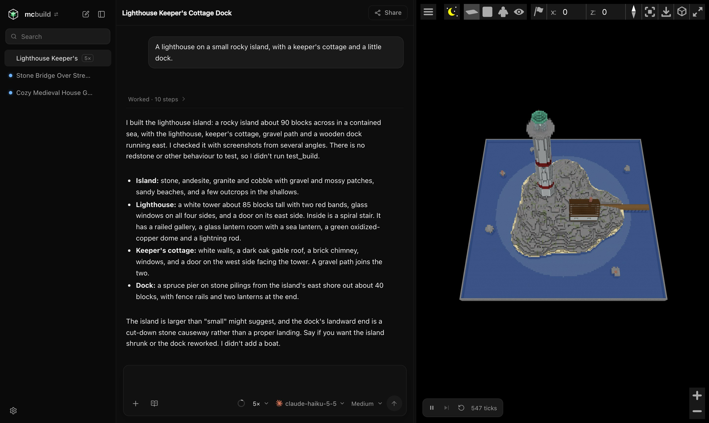

# mcbench-lite

A local web app in which AI models build in Minecraft. You chat with a model, it builds in a Minecraft world shown in a 3D viewer beside the chat, and follow-ups change the same world. Bench mode gives a prompt to several models at once so you can compare their builds and vote on them.



## How it differs from MC-Bench

In [MC-Bench](https://github.com/mc-bench) a model gets a prompt and writes one program in a single response, and the result is what people vote on. Here the model works as an agent. I have given it tools, and it uses them in a loop until it decides the build is done.

| Tool | Utility |
|---|---|
| `build` | Runs a JavaScript program against the world |
| `see_build` | Takes screenshots of the build and looks at them |
| `test_build` | Runs the build in a Minecraft engine to check redstone and other behaviour |
| `bash` | Runs scripts and calculations in a sandboxed shell |

It also runs on your own machine, with the models and harnesses you connect.

## Why an agent?

A single response shows what a model can write without seeing the result. Models are now, by far, mainly used as agents. They can act, look at what happened and correct it. A build has to be looked at to be judged, so here the model can look at it too, and test it. I've found this reflects model capability much more realistically.

Everything below has been written by Claude and reviewed by me.

## The engine

The engine in `core/` is a Rust reimplementation of Minecraft 1.21.10's block update code: redstone, pistons, hoppers, water and lava, light, TNT. On 82 community builds and 700 random worlds, every reply and file it writes is byte for byte what a reference engine built from Minecraft's own server classes writes. On the same 82 builds, that reference engine's test reports match a real Paper server's. What the engine does not model fails with `unported: …` and is never approximated. Mobs are not modelled. Random ticks, weather and the day cycle are off, so crops do not grow and it is always noon.

A faster way to light the running world was written and not shipped, because the light came out different in 1 of 82 builds.

## Network use

There is no hosted version and no telemetry. The app contacts the providers you connect, and openrouter.ai for its public list of models. On the first start it downloads its JDK from GitHub (Adoptium's Temurin releases), rustup from static.rust-lang.org and through it Rust from rust-lang.org, Chromium's headless shell from cdn.playwright.dev, Paper and the Minecraft server from Paper and Mojang, and BlueMap and misode/mcmeta from GitHub. It contacts Docker Hub, PyPI and Debian when it builds the shell's image. When you ask it to install Claude Code or Codex CLI, it downloads Claude Code from Anthropic's release bucket on storage.googleapis.com, or Codex from GitHub (openai/codex). It contacts GitHub and your Pages site when you share a build. Claude Code is started with its non-essential traffic off. The Cursor SDK ships with its own analytics code, which the app neither uses nor turns off.

## Setup

```bash
curl -fsSL https://raw.githubusercontent.com/adonis-singh/mcbench-lite/main/install.sh | bash
```

This clones the repository into `~/mcbench-lite` (`MCBENCH_DIR` names another folder) and runs `./start` there. `./start` downloads the app's own Node.js 26.13.1 into `~/.mcbench-lite/tools` and checks its checksum, installs the packages, starts the server and opens the app in your browser once the server answers. Before anything is downloaded, both say what is missing from the table below and the command that installs it.

To start the app again later, run `~/mcbench-lite/start` (`--no-open` opens no browser). Running the install command again updates the clone with `git pull --ff-only` first.

The browser opens `http://mcbench-<label>.localhost:<port>/?token=…`, which the server also prints on every start. The token is made once per data folder (`data/auth-token`, readable by your account alone) and signs the browser in, so no other account or process on the machine can use the app. The port is 3020 unless `PORT` says otherwise.

## What you need

The app runs on macOS and Linux, on arm64 or x64 (other platforms are refused). You can bully Claude to get it to work for Windows and submit a PR; I have no intention of doing so myself.

| What | Why | How to get it |
|---|---|---|
| The Xcode Command Line Tools, on a Mac | `cc`, which the Rust compiler links the engine with, git, and `python3`, which runs the MCP bridge of the Claude Code and Codex CLI harnesses | `xcode-select --install` |
| `cc`, `python3`, `curl`, `xz` and git, on Linux | `cc` links the engine, `python3` runs the MCP bridge of the Claude Code and Codex CLI harnesses, `curl` and `xz` download and unpack Node.js, git clones the repository | `build-essential python3 curl xz-utils git` on Debian and Ubuntu |
| bubblewrap at `/usr/bin/bwrap`, `prlimit` from util-linux and unprivileged user namespaces, on Linux | build programs run in that sandbox (`server/build-sandbox.js`); on macOS they run under the built-in `sandbox-exec`. `./start` has bubblewrap make one first, and when it cannot, prints bubblewrap's reason and, if a kernel setting forbids user namespaces (AppArmor's restriction on Ubuntu 24.04 and later, `kernel.unprivileged_userns_clone` on Debian, `user.max_user_namespaces=0`), the command that allows them | `bubblewrap util-linux` on Debian and Ubuntu |
| The headless Chromium's shared libraries (GLib, NSS, ATK, D-Bus, the X11 client libraries, libgbm, libxkbcommon, ALSA), on a Linux without a desktop | `see_build`'s headless browser loads them. A desktop Linux has them; a server or container install does not. The first start checks that the browser starts, and when it cannot, the setup screen names the missing libraries and the command that installs them; after running it, Try again | Playwright's `install-deps chromium`, run as root with the app's Node.js, on Debian and Ubuntu: the setup screen prints the whole command |
| Docker | only for the model's bash shell, and for Codex CLI on Linux | [Docker Desktop](https://www.docker.com/products/docker-desktop/) on a Mac, Docker Engine on Linux |
| gh, signed in, and git | only for Share | `brew install gh` or your package manager, then `gh auth login` |

Node.js, Rust, the JDK and the Chromium shell for `see_build` are the app's own: `./start` and the server download them into `~/.mcbench-lite/tools` (`MCBENCH_TOOLS_DIR` names another folder), whatever versions the system has. The app starts without Docker or gh and says what is missing when it is first needed.

### From a clone

```bash
git clone https://github.com/adonis-singh/mcbench-lite.git
cd mcbench-lite
./start
```

`npm install && npm start` with a Node.js of your own, 22.13 to 26, still works; `./start` always runs its own. better-sqlite3 is built for one Node.js version, so in a folder `./start` has installed, run `npm rebuild` with yours first when its major version is not 26; `./start` installs the packages again after that. API keys go in Settings, or in `.env` (`install -m 600 .env.example .env`).

## The first start

The page opens at once; the first start then prepares the rest in the background. The terminal says what it is doing, one line per step, and `[startup] ready` when everything is prepared; the page reads the same steps, with their download progress, from `GET /api/setup`. With an empty tools folder and data folder it took 73 seconds on a recent Mac with a fast connection, most of it reading Minecraft's tables and compiling the engines. Each step needs to happen only once, so later starts are ready in about two seconds.

| Step | Download | Where it goes |
|---|---|---|
| Temurin 25.0.5+8, a JDK, which runs Paper, reads Minecraft's tables and makes the viewer's assets | about 130 MB (300 MB on disk) | the tools folder |
| rustup 1.29.3, then through it Rust 1.99.1 and its WebAssembly target (`core/rust-toolchain.toml`) | 12 MB, then about 550 MB on disk | `rust/` in the tools folder |
| Chromium's headless shell, the build playwright-core names (149.0.7827.55), which takes `see_build`'s screenshots | about 100 to 120 MB (190 MB on disk) | the tools folder |
| Paper 1.21.10, and through it the Minecraft server and its libraries from Mojang | about 55 MB, then about 135 MB | `data/minecraft-live/paper` |
| Minecraft's block, loot and data fixer tables, read from that server jar | none | `core/minecraft/1.21.10` |
| Minecraft's block data from misode/mcmeta | about 4 MB | `data/assets` |
| BlueMap 5.22's command-line tool, and the Minecraft 1.21.10 client jar from Mojang (the viewer's textures and models) | about 7 MB and 31 MB | `data/minecraft-live/bluemap` |
| The Rust engine, compiled natively and to WebAssembly with those tables | none | `core/target` |
| The model's shell image, from `python:3.12-slim` and packages from PyPI and Debian, when Docker is running | a few hundred MB | Docker |

The tools folder is `~/.mcbench-lite/tools`, or the folder `MCBENCH_TOOLS_DIR` names. Every checkout and data folder on the machine shares it, so a second checkout downloads none of it again. Each program in it is pinned to a version and to the sha256 of its download for macOS and Linux on ARM and Intel, and a download whose bytes differ fails and is not kept. Nothing is installed anywhere else: rustup and Rust live in the tools folder (the app runs them with `RUSTUP_HOME` and `CARGO_HOME` there), and no shell profile, `PATH` or `~/.rustup` is changed. `MCBENCH_JAVA` and `MCBENCH_JAVAC` name another JDK, which the app then uses instead of downloading one.

The shell's image is built in the background while the app starts, so the first bash call does not wait for it. Without Docker, or with Docker not running, the app starts all the same; the step says what is missing, and so does the model's bash tool until Docker runs.

The repository does not contain Minecraft code, jars, textures or data tables. The engine is a reimplementation that is built with Minecraft's tables (every block, state, collision shape, item and loot table, and the data fixer's rules), and the app reads those tables on your machine from the server jar it downloaded, with the project's own Java code, into `core/minecraft/1.21.10/`, which git ignores.

The app downloads the Minecraft server (through Paper) and the Minecraft client jar from Mojang's servers to your machine, and accepts the Minecraft End User Licence Agreement on your behalf: it writes `eula=true` for Paper and sets BlueMap's `accept-download: true`. Read the EULA at https://www.minecraft.net/eula; by running the app you agree to it.

## Connecting an AI

While no AI is connected, the first screen has a **Connect an AI** button. Otherwise open Settings (the gear at the bottom left) and choose Connect an AI. Then pick a model with the model button in the prompt box; typing in its search box searches every connected provider. A provider needs one of these:

| Provider | How to connect |
|---|---|
| OpenRouter, OpenAI, Anthropic, Groq, Google, QwenCloud, Cursor | an API key, in Settings, in `.env` or exported in the shell that starts the app (`OPENROUTER_API_KEY`, `OPENAI_API_KEY`, `ANTHROPIC_API_KEY`, `GROQ_API_KEY`, `GOOGLE_API_KEY`, `QWENCLOUD_API_KEY`, `CURSOR_API_KEY`); Cursor can instead sign in with your Cursor account from its pane in Settings |
| Claude Code (your Claude subscription, or an Anthropic Console account) | sign in from the Claude Code pane in Settings; it needs the `claude` CLI, which the app installs from Connect an AI when you have none |
| Codex CLI (your ChatGPT subscription, Codex's own agent) | sign in from the Codex CLI pane in Settings; it needs the `codex` CLI, which the app installs from Connect an AI when you have none |
| ChatGPT (your ChatGPT subscription, mcbench's own agent) | sign in from the ChatGPT pane in Settings; it is the same sign-in as Codex CLI, with the same `codex` CLI |

A CLI you already have is the one the app runs: the one `MCBENCH_CLAUDE_BINARY` or `MCBENCH_CODEX_BINARY` names, else `claude` or `codex` on your `PATH`. When there is none, Connect an AI can install Claude Code 2.1.311 or Codex CLI 0.167.1 into the tools folder (about 280 MB and 170 MB), each pinned by version and sha256 as the first start's downloads are, and the app runs that one from then on. It does not touch your `PATH`, and the CLI's login and settings stay where the CLI keeps them (`~/.claude`, `~/.codex`).

Signing in from Settings runs the provider's own login: `claude auth login` with the method you pick (Claude subscription or Anthropic Console), `codex login --device-auth`, or the Cursor SDK's login. The pane shows the address the login prints, which you open in a new tab, and Codex's one-time code; for Claude Code you paste the code its page shows back into the pane, which passes it to the CLI. The app opens no browser itself, keeps nothing you paste, and reads only the account and plan from the login the CLI stores. "Sign out" runs the CLI's own logout. `npm run codex:login` and `npm run cursor:login` still sign in from a terminal.

ChatGPT sign-in uses the Codex CLI login in `$CODEX_HOME/auth.json` (default `~/.codex/auth.json`); the server uses that login directly, in its own process, so nothing listens on a port for it. Keys are kept in `data/settings.json` and never sent to the browser.

An API key is billed by its provider. The sign-ins use your subscription and count against its limits; the app shows the plan's limit warning when the provider sends one.

## Using it

The app has two modes, Build and Bench, and its logo reads "mcbuild" in Build and "mcbench" in Bench.

**Build** (⌘1) is a chat: ask for a build ("a cozy medieval house"), and the model writes build programs, looks at its work and tests redstone; the build appears in the live world beside the chat, where you can pause, step, or fly around. A click uses a lever, button, door, trapdoor, fence gate, repeater, comparator, note block, daylight detector, redstone dust or decorated pot, as in Minecraft. Player mode puts you in the world as a creative Minecraft player who can walk and fly. Follow-ups edit the same world, and "Edit and branch" on a message goes back to it. Select blocks in the viewer (Alt+S) to refer to them in your next message. A message can also carry up to 8 attached files: images are shown to the model when it accepts images, and every file is in its shell's `/work/attachments`.

**Bench** (⌘2) sends one prompt to 2 to 8 models at once and shows their builds side by side in one world; follow-ups go to all of them as rounds. One model can run at several reasoning efforts in the same bench. With **Blind** on, the builds are named A, B, C until you reveal the models: vote for the best build of each round, or a tie. The Leaderboard is an Elo rating over the blind votes in benches that are not archived: every model starts at 1000, the picked build beats each other build of its round (K = 24), a tie is a draw between all of them, and a model at two efforts has two entries. The Leaderboard is local: it holds your own votes on your own prompts.

The **prompt library** is in Bench: saved prompts with tags, in which `{{fill-ins}}` are parts you fill in each time. Type "/" in the prompt box to insert one. "Improve with AI" rewrites a prompt with a model you choose, and "Run bench" starts a new bench with the prompt in the prompt box.

The **resolution** picker in the prompt box asks for larger, more detailed builds: Standard (1×), High (2×), Very high (5×) or Maximum (10×). Your last choice is kept.

**Share** publishes a chat's build, or a bench's builds, as a public page to a GitHub Pages repository you name in Settings (`owner/name`), with `git` and `gh`. The page is a static copy of the 3D viewer, in which anyone can fly or orbit around the build as it was when published. A bench's page has a button per model. On X the link shows as a card that plays the viewer, and the share box has a "Post on X" button. Settings lists what you have published and can remove any of it. A shared build's public page includes Minecraft's block textures, made from that client jar, as a BlueMap map does.

The viewer's toolbar also downloads a build as a WorldEdit schematic (`.schem`) or as a Minecraft world to open in the game. ⌘K searches every chat and bench.

## What the model can do on your machine

The model works through the app's tools, and each is confined:

| Tool | Where it runs | What it can reach |
|---|---|---|
| Build programs (JavaScript) | A sandbox that can open no file and has no network: `sandbox-exec` on macOS, bubblewrap on Linux | The chat's world, and files in that chat's own folder, which the server reads and writes for it |
| `bash` | A Docker container | That chat's own folder. No network, except one-shot commands the model asks for. Those reach the public internet with that folder mounted, and cannot reach your machine or your local network |
| Claude Code and Codex CLI | On your machine, as the signed-in CLI (Codex in a container on Linux) | Only mcbench's tools. Claude Code's own file and shell tools are off; Codex runs read-only, and its turn is ended if it uses a tool of its own |

Your provider keys and sign-in tokens are never given to the model. `SECURITY.md` says what the app defends against and what it does not.

## Licence

mcbench-lite's code is under the MIT licence (`LICENSE`): anyone may use, change and redistribute it, as long as they keep the licence notice, which names this repository. `NOTICE.md` lists what is not covered (BlueMap's material and the ports of Java's math) and says what the app downloads from Mojang.

Not an official Minecraft product. Not approved by or associated with Mojang or Microsoft.

## Contributing

[CONTRIBUTING.md](CONTRIBUTING.md) has what you need to work on the code: the commands, the rules, where things are and how to check the engine against Minecraft.
